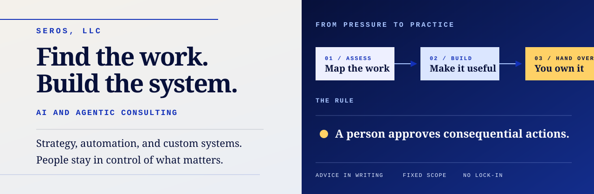

# Make AI useful. Keep people in control.

**AI and agentic consulting.** Written advice, defined scope, and practical systems you own. 
A person approves every consequential action.

  
  
  
  

  <a href="https://seros.dev/contact"><b>Book a Discovery Call</b></a> •
  <a href="https://seros.dev/services"><b>Services & Deliverables</b></a> •
  <a href="https://seros.dev/pricing"><b>Engagement Model</b></a> •
  <a href="https://seros.dev/work"><b>Engineering Work</b></a>

---

## What We Do

Seros, LLC helps leadership teams decide where AI belongs in their business, what to leave alone, and what to build. We put our thinking and system architecture in writing before building software.

We deliver across **six distinct consulting offers**:

| Service | Scope & Deliverables |
|:---|:---|
| **AI strategy and readiness assessment** | End-to-end evaluation of current workflows, data infrastructure, risks, and feasibility. Delivered as a prioritized execution roadmap. |
| **Advisory retainer** | Direct, ongoing guidance on AI tooling decisions, vendor evaluation, architecture reviews, and team implementation. |
| **Agentic workflow automation** | Purpose-built autonomous agents connected to your operational tools, with deterministic state machines and mandatory human approval. |
| **AI-native custom CRM** | Tailored relationship tracking, contact graph intelligence, and communication automation aligned with your actual operational flows. |
| **Custom builds and integrations** | Bespoke connectors, custom pipelines, and software tools bridging gaps across your legacy software stack. |
| **Care plan** | Ongoing system maintenance, prompt & model updates, dependency upgrades, and operational health monitoring. |

<a href="https://seros.dev/services">Explore service details →</a> · <a href="https://seros.dev/pricing">Review engagement pricing →</a>

---

## Principles of Engagement

- **Start with Discovery:** A free initial call to understand your process, operational bottlenecks, and determine mutual fit.
- **Written Agreement First:** A paid readiness assessment informs the plan. Build scope, fixed milestones, and fees are agreed in writing before any engineering starts.
- **Human Approval by Design:** Critical decisions and consequential actions—moving capital, customer-facing outreach, or mutating essential database records—require explicit human confirmation by design.
- **Client Ownership:** You retain 100% ownership of your source code, deployment infrastructure, and vendor accounts. No proprietary lock-in.
- **Target Audience:** We work with technical founders, operators, and leadership teams who already understand agentic concepts and want reliable, production-tested delivery.

> **Transparent Pricing:** Professional consulting and engineering services are billed at **$150/hour**. Strategic assessments and fixed-fee builds are quoted clearly after discovery.

---

## Public Engineering Work

These repositories showcase our internal engineering discipline, architectural decision-making, and public artifacts. They are published as delivery evidence of how we think and build:

| Repository | Focus & Contents |
|:---|:---|
| [**Seros-LLC/website**](https://github.com/Seros-LLC/website) | Source code for [seros.dev](https://seros.dev): responsive static HTML, design token architecture, and Python rendering pipeline for legal documents. |
| [**Seros-LLC/seros**](https://github.com/Seros-LLC/seros) | Architectural specification of our paused product: system design, Architecture Decision Records (ADRs), data models, security controls, and operational runbooks. |
| [**Seros-LLC/.github**](https://github.com/Seros-LLC/.github) | Organization profile, community health standards, vulnerability reporting guidelines, and contributing policies. |

Browse the public technical documentation:
- 📐 [System Architecture Blueprint](https://github.com/Seros-LLC/seros/blob/main/docs/ARCHITECTURE.md)
- 📋 [Architecture Decision Records (ADRs)](https://github.com/Seros-LLC/seros/tree/main/docs/adr)
- 🛡️ [Security Controls & Isolation Strategy](https://github.com/Seros-LLC/seros/blob/main/docs/SECURITY-CONTROLS.md)

---

## Contact & Inquiries

- **Engagements & Consultations:** [Book a discovery call](https://seros.dev/contact) or email [`team@seros.dev`](mailto:team@seros.dev).
- **Public Project Inquiries:** [Open an issue](https://github.com/Seros-LLC/.github/issues/new/choose) on our `.github` repository. Read our [Contributing Guide](https://github.com/Seros-LLC/.github/blob/main/CONTRIBUTING.md) before submitting.
- **Security Inquiries:** Security vulnerabilities must be reported privately. Follow our [Security Policy](https://github.com/Seros-LLC/.github/blob/main/SECURITY.md) or use private vulnerability reporting on the relevant repository.

  © 2026 Seros, LLC · Georgia, USA · <a href="https://seros.dev">seros.dev</a>

